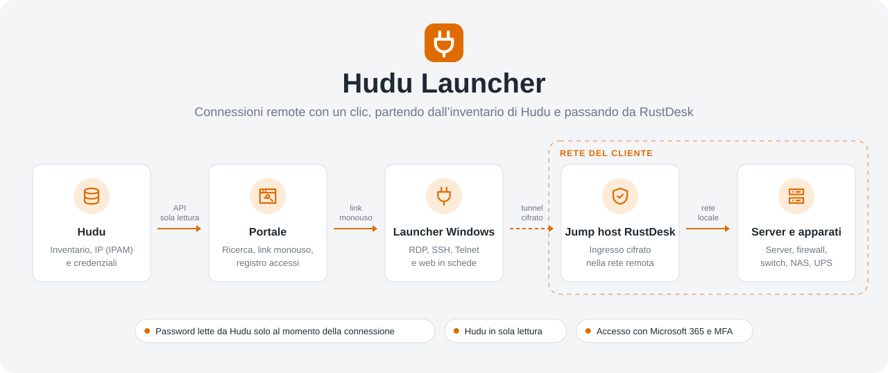

<p align="center">
  <picture>
    <source media="(prefers-color-scheme: dark)" srcset="docs/images/hero-dark.svg">
    
  </picture>
</p>

<p align="center">
  <a href="../../releases/latest">Scarica il Launcher</a> ·
  <a href="docs/INSTALLAZIONE.md">Installazione</a> ·
  <a href="docs/ARCHITETTURA.md">Architettura</a> ·
  <a href="docs/SICUREZZA.md">Sicurezza</a>
</p>

**Hudu Launcher** trasforma l'inventario di [Hudu](https://www.hudu.com) in un punto unico da cui
aprire le connessioni remote: si cerca un server, un firewall o uno switch e con un clic si apre la
sessione RDP, SSH, Telnet o web, già autenticata, anche dentro reti raggiungibili solo tramite un
jump host [RustDesk](https://rustdesk.com).

Hudu resta l'unica fonte di verità: indirizzi, credenziali e documentazione si aggiornano lì, e il
Launcher li usa senza duplicarli.

## Come funziona

1. **Il portale** (container Docker) legge da Hudu, in sola lettura, clienti, asset, IP dell'IPAM e
   nomi delle credenziali, e dalla rubrica di RustDesk i dispositivi da usare come jump host.
2. **Si cerca e si clicca**: il portale crea un link monouso `hudulauncher://` valido 30 secondi,
   che non contiene né indirizzi né password.
3. **Il Launcher per Windows** riceve il link, verifica l'utente con Microsoft 365 e scambia il
   link con i dati della connessione; solo in quel momento la password viene letta da Hudu.
4. **RustDesk apre un tunnel cifrato** fino al jump host nella rete remota (oppure la connessione
   parte diretta, se si è già in quella rete o in VPN) e la sessione si apre in una scheda.

Ogni connessione, e ogni credenziale consegnata, finisce nel registro accessi del portale.

## Funzionalità

- **Ricerca immediata** per cliente, nome, IP o hostname, con preferiti e connessioni recenti.
- **Desktop remoto integrato** con opzioni impostabili per tutti e per singolo asset (appunti,
  unità, stampanti, sessione `/admin`, WebAuthn, audio, tasti di Windows).
- **SSH e Telnet** in un terminale con evidenziazione configurabile (errori, interfacce, IP, MAC,
  prompt degli apparati di rete) e verifica delle chiavi host.
- **Interfacce web** di firewall, NAS, iDRAC/iLO aperte in una scheda attraverso lo stesso tunnel.
- **Jump host automatico**: il gateway RustDesk si ricava da Hudu, dal cliente o dal dispositivo
  stesso; in alternativa connessione **diretta**.
- **Indirizzi dall'IPAM di Hudu**, con segnalazione degli asset senza IP o con più IP da scegliere.
- **Modifiche in blocco** su più asset (gateway, credenziale, protocollo, visibilità).
- **Cache d'emergenza**: fino a N connessioni preparate in anticipo, tenute solo in memoria per un
  tempo limitato, utilizzabili anche senza internet.
- **Accesso con Microsoft 365** (Entra ID) e amministratori di emergenza locali con MFA.
- Tema chiaro e scuro, interfaccia in italiano.

## Sicurezza in breve

- La chiave API di Hudu resta sul server, cifrata; il codice blocca qualsiasi richiesta verso Hudu
  che non sia una lettura.
- Le password non vengono salvate: si leggono al momento della connessione e non si possono copiare
  né dal portale né dal Launcher.
- Link monouso da 256 bit, legati all'utente e validi 30 secondi; il Launcher deve presentare anche
  un token Microsoft 365 dello stesso utente.
- Content Security Policy rigorosa, protezione CSRF, limiti per IP, blocco degli account, container
  non root in sola lettura.
- Analisi automatiche a ogni modifica: CodeQL, Semgrep, analizzatori .NET, controllo delle librerie
  vulnerabili e Dependabot.

I dettagli sono in [`docs/SICUREZZA.md`](docs/SICUREZZA.md).

## Requisiti

| Componente | Requisito |
|---|---|
| Hudu | Chiave API con accesso alle password |
| RustDesk | Server Pro (rubrica condivisa e API) e client RustDesk sui PC |
| Identità | Tenant Microsoft Entra ID (Microsoft 365) |
| Portale | Host Docker dietro un reverse proxy o WAF con HTTPS |
| Launcher | Windows 10 o 11 (installazione per utente, senza diritti di amministratore) |

## Installazione rapida

- **Portale**: immagine `ghcr.io/nicolafilippetto/hudu-launcher/launcher-server` (`latest` o una
  versione, es. `1.1.0`) con [`server/docker-compose.yml`](server/docker-compose.yml).
- **Launcher**: `HuduLauncher-win-Setup.exe` dalle [Release](../../releases/latest), con
  `SHA256SUMS.txt` per verificarlo.

La guida completa (Entra ID, chiavi API, reverse proxy, firewall, distribuzione con Intune) è in
[`docs/INSTALLAZIONE.md`](docs/INSTALLAZIONE.md).

## Contenuto del repository

| Cartella | Cosa contiene |
|---|---|
| [`server/`](server) | Portale web e API (ASP.NET Core 10, SQLite), Dockerfile, `docker-compose.yml`, test |
| [`connector/`](connector) | Launcher per Windows (WPF .NET 10), installer Velopack, test |
| [`docs/`](docs) | Installazione, architettura, sicurezza |
| [`scripts/`](scripts) | Script PowerShell di prova (tunnel RDP e web con RustDesk, IPAM di Hudu) |

## Sviluppo

Serve il .NET SDK 10.

```bash
# Portale: test e avvio locale (http://localhost:5080, dati in server/src/Launcher.Server/local-data)
cd server
dotnet test
ASPNETCORE_ENVIRONMENT=Development dotnet run --project src/Launcher.Server --urls http://localhost:5080

# Launcher: test della logica (anche su Linux) e compilazione
cd connector
dotnet test tests/Launcher.Connector.Tests
dotnet build src/Launcher.Connector -c Release
```

Il Launcher si compila anche su Linux ma si esegue solo su Windows. Le pipeline GitHub eseguono i
test e le analisi di sicurezza a ogni modifica; un tag `vX.Y.Z` pubblica l'immagine Docker e
l'installer nelle Release.

## Contribuire

Segnalazioni e proposte sono benvenute tramite issue e pull request. Le vulnerabilità vanno
segnalate in privato, come spiegato in [`SECURITY.md`](SECURITY.md).

## Licenza

[MIT](LICENSE).

Progetto indipendente, non affiliato a Hudu Technologies né a RustDesk: i nomi appartengono ai
rispettivi proprietari e sono usati solo per indicare con cosa si integra.
